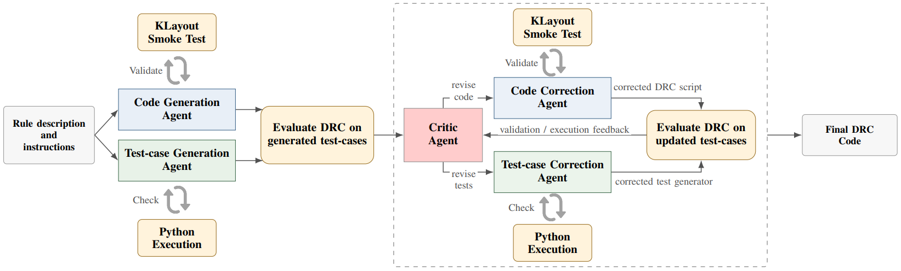

# EGAR-DRC: Execution-Guided Agentic Repair for DRC Script Synthesis

EGAR-DRC turns natural-language design rules into executable KLayout DRC
scripts. Instead of sampling many candidates and picking one, it follows a
single repair trajectory: generated scripts and generated layout tests are
compiled and executed, and a critic decides whether the script, the tests, or
both need repair.



## Installation

EGAR-DRC requires Python 3.10+, [KLayout](https://www.klayout.de/) with Ruby and
Python support on your `PATH`, and an OpenAI-compatible model API endpoint.

```sh
git clone https://github.com/Ali-Tarhini/EGAR-DRC.git
cd EGAR-DRC
python -m pip install '.[dataset]'
```

Edit `model_config.yaml` to point to your model endpoint.

## Quick Start

From the repository root:

```sh
# Download the benchmark into data/Rule2DRC
egar-drc-prepare-dataset --output-dir data/Rule2DRC

# Run EGAR-DRC on one problem
egar-drc-run --flow egar-drc --model-config model_config.yaml \
    --repository data/Rule2DRC --output-dir results/egar --problem 0001

# Re-score the run and summarize its metrics
egar-drc-evaluate results/egar --repository data/Rule2DRC
```

Omit `--problem` to run the full benchmark, and add `--jobs N` to solve
problems in parallel. Every command lists its options with `--help`.

The benchmark is the [Rule2DRC dataset](https://huggingface.co/datasets/jusjinuk/Rule2DRC).
Its gold scripts and labels are used only for scoring, never by the agents.

## Flows

| `--flow` | Description | Script |
| --- | --- | --- |
| `egar-drc` | Full EGAR-DRC: repairs scripts and generated tests. | `run_egar_drc.sh` |
| `code_only_repair` | Repairs scripts only, against a fixed generated test suite. | `run_code_only_repair.sh` |
| `code_generation_baseline` | Generation with compilation feedback only. | `run_code_generation_baseline.sh` |
| `single_sample_baseline` | A single generation, without feedback. | `run_single_sample_baseline.sh` |

## Scripts

[scripts/](scripts) runs the same steps with the paths above preset and 64
parallel jobs. Each script works from any directory, and extra arguments
override its defaults:

```sh
sh scripts/00_prepare/prepare_dataset.sh
sh scripts/01_generate/run_egar_drc.sh            # writes results/egar
sh scripts/01_generate/run_code_only_repair.sh    # writes results/code_only_repair
sh scripts/02_evaluate/run_evaluation.sh          # evaluates results/egar
```

The evaluation script also accepts a run directory as its first argument, for
example `sh scripts/02_evaluate/run_evaluation.sh results/code_only_repair`.

## Results

Each run directory contains `results.jsonl`, `summary.json`, `run.log`, and a
folder per problem with the final DRC script and its execution evidence.
Evaluation writes its reports, including `metrics.json`, to the run's
`evaluation/` directory.

See [docs/ARCHITECTURE.md](docs/ARCHITECTURE.md) for how the repair loop works and
[docs/EVALUATION.md](docs/EVALUATION.md) for the metrics and output files.


